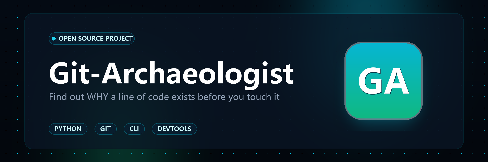

<div align="center">



# 🏛️ Git-Archaeologist

**Find out WHY a line of code exists before you touch it.**  
*Bypasses formatting noise, finds the true original commit, and surfaces linked issues & tests.*

[](LICENSE)
[](https://python.org)
[]()
[]()
[](README_CN.md)

*“Do not remove a fence until you know why it was put up in the first place.” — Chesterton's Fence Principle*

[English](README.md) | [中文说明文档](README_CN.md)

</div>

---

## 🎯 The Dilemma: Why Shallow `git blame` Fails

Every software engineer has stared at a bizarre piece of legacy code:

```python
if retry_count > 3 and not connection.is_draining:
    time.sleep(0.15)  # WHY 150ms? Who added this? Is it safe to delete?
```

You run standard `git blame file.py`:
```text
a8f9c10 (Alice  2026-08-10) time.sleep(0.15)
Commit message: "style: run black and reindent"
```

**Result: Total failure.** The blame points to a superficial linter or reformatting commit. You spend the next 45 minutes manually sifting through `git log -S` and commit diffs trying to figure out why this line exists. If you blindly delete it, you risk causing an edge-case concurrency crash in production.

**Git-Archaeologist solves this fundamentally.**

---

## ⚡ Architecture & How It Works

<div align="center">

</div>

Git-Archaeologist walks backwards through commit history:
1. **Target Selection**: Specify any file and line range (`path/to/file.py:42-50`).
2. **Bypass Formatting Noise (Churn Bypass)**: Automatically skips past commits that only ran `black`, `prettier`, reindented lines, or reformatted whitespace.
3. **Pinpoint the Original Commit (Genesis Commit)**: Discovers the exact commit where this logic was first introduced.
4. **Inspect Coupled Changes (Co-change)**: Finds other files modified in that same commit, notably any unit tests (e.g. `tests/test_stall.py`) added to verify the behavior.
5. **Estimate Refactoring Risk (0-100)**: Assesses how risky it is to modify or remove this code based on its age, original commit intent (hotfix, security, feature), and whether protective tests exist.

---

## ✨ Key Features

- **🛡️ 100% Zero Runtime Dependencies**: Pure Python 3.8+ standard library. No bloated wheels, no network dependencies, completely offline and privacy-preserving.
- **🧹 Intelligent Churn Bypass**: Penetrates commits with keywords like `format`, `lint`, `prettier`, `black`, `isort`, or whitespace-only diffs to find the authentic origin.
- **🐕 Guard-Dog Test Discovery**: Identifies co-committed regression test files that guard the invariants of the code segment.
- **🎫 Traceable Issue & CVE Excavation**: Automatically detects associated GitHub/GitLab issues (`#1842`), Jira tickets (`PROJ-102`), and CVE security references (`CVE-2026-xxxx`).
- **📊 Multi-Modal Dossiers**:
  - **ANSI Terminal Output**: Rich colored hierarchy tree and risk gauges in your terminal.
  - **Standalone Interactive HTML Report**: Glassmorphic dark-mode web report with interactive commit diff toggle and SVG risk gauges (zero CDN dependencies).
  - **GitHub-Flavored Markdown**: Copy-pasteable into PR comments and code review threads.
  - **Agent JSON Format**: Machine-readable format ready for AI agents (Antigravity, Cursor, Claude).

---

## 🚀 Quick Start

### Installation

```bash
# Clone the repository
git clone https://github.com/Mianm-l/git-archaeologist.git
cd git-archaeologist

# Optional: Install as an editable CLI tool
pip install -e .
```

### Basic Excavation

```bash
# Excavate a specific line or line range
python -m git_archaeologist excavate src/network.py:42-45

# Or use the installed CLI directly:
git-archaeologist excavate src/network.py:42
```

### Generating an Interactive HTML Report

```bash
git-archaeologist excavate src/network.py:42 --format html --output report.html
```

Open `report.html` in any browser to explore the interactive visual timeline and risk analysis.

### Generating Markdown for PR Reviews

```bash
git-archaeologist excavate src/network.py:42 --format md --output review.md
```

---

## 📊 Archaeological Risk Index (Chesterton's Fence)

| Risk Score | Level | Meaning & Actionable Guidance |
| :---: | :---: | :--- |
| **80 - 100** | **CRITICAL LOAD-BEARING** | 🛑 **Do not touch without verification.** Code introduced for emergency bugfix/security patch with high longevity. Run co-committed tests before any change. |
| **60 - 79** | **HIGH** | ⚠️ **Proceed with caution.** Invariants exist. Verify original tickets and regression test suite. |
| **35 - 59** | **MODERATE** | 🟡 **Standard refactoring risk.** Normal business capability. Ensure standard test suites pass. |
| **0 - 34** | **LOW / SAFE** | 🟢 **Safe to refactor or delete.** Recent or cosmetic logic with low defensive entanglement. |

---

## 🤖 AI Agent Skill Integration

`git-archaeologist` includes a standardized Agent Skill definition at `git_archaeologist/skill/SKILL.md`.

AI Coding Assistants (such as Antigravity, Claude Code, or Cursor) can invoke `git-archaeologist excavate <path>:<line> --format json` before attempting risky refactorings, ensuring the AI never unwittingly deletes load-bearing code!

---

## 🧪 Running Tests

```bash
python -m unittest discover -s tests -p "test_*.py" -v
```

All tests run locally using Python's standard library `unittest` and verify churn bypass on simulated Git repositories.

---

## 📄 License

Released under the [MIT License](LICENSE). Built with ❤️ by [Mianm-l](https://github.com/Mianm-l).
