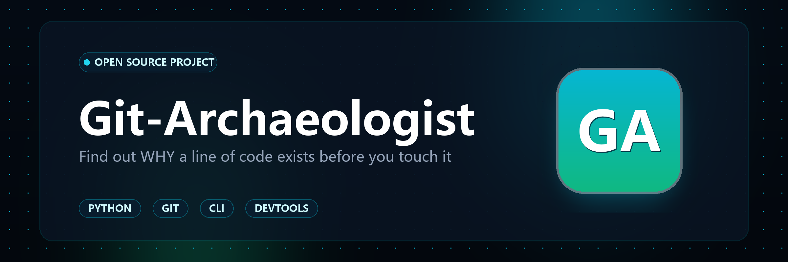

<div align="center">



# 🏛️ Git-Archaeologist (代码考古)

**接手老代码不敢动？穿透格式化与批量修改，查清任意代码最初为什么写、改动有什么风险。**

[](LICENSE)
[](https://python.org)
[]()
[]()
[](README.md)

*“在搞清楚一堵栅栏为什么立在这里之前，绝不要轻易拆掉它。” —— 切斯特顿之栅法则*

[English](README.md) | [中文说明文档](README_CN.md)

</div>

---

## 🎯 痛点背景：为什么普通的 `git blame` 总是失效？

每一个接手遗留系统的工程师，都曾面对过令人费解的代码片段：

```python
if retry_count > 3 and not connection.is_draining:
    time.sleep(0.15)  # 为什么是 150ms？这是谁加的？删了会炸吗？
```

当你习惯性地执行 `git blame file.py`:
```text
a8f9c10 (Alice  2026-08-10) time.sleep(0.15)
Commit message: "style: run black and reindent"
```

**排查陷入僵局。** 普通的 blame 只能看到最后一次格式化、Linter 修复或变量重命名。为了查清它的真正死因，你不得不耗费数十分钟在 `git log -S` 与漫长的提交历史中大海捞针；如果贸然删掉这行代码，很可能在生产环境重现数年前的偶发并发死锁。

**Git-Archaeologist 专为终结这一痛点而生。**

---

## ⚡ 架构设计与工作原理

<div align="center">

</div>

Git-Archaeologist 的工作流程：
1. **指定代码范围**：输入任意文件或代码行号区间（例如 `src/network.py:42-50`）。
2. **穿透格式化干扰（Churn Bypass）**：自动识别并跳过代码格式化、Linter 调整、纯缩进修改或大批量空行变更等表面提交。
3. **定位最初引入该代码的提交（Genesis Commit）**：一路下潜回溯到这段逻辑真正诞生的第一天。
4. **挖掘当时的关联修改（Co-Change）**：分析当时同一次 Commit 还改了哪些文件，重点检索当年是否附带了对应的单元测试（如 `tests/test_stall.py`）。
5. **评估修改与删除风险（0-100）**：根据代码存活年限、提交意图（紧急修复 / 安全补丁 / 普通需求）及保护测试是否存在，输出改动建议。

---

## ✨ 核心特性

- **🛡️ 纯标准库零外部依赖**：基于 Python 3.8+ 原生标准库，纯本地离线运行，绝对无网络请求，保护企业代码资产隐私。
- **🧹 智能噪声过滤引擎**：多维度正则启发式识别 `format`、`lint`、`style`、`whitespace` 提交及纯空行/缩进 diff，直抵代码本质。
- **🐕 伴生测试雷达**：自动扫描创生提交中的 `test_*.py`、`*.spec.ts`、`*Test.java`，明确告知这行代码受到哪些测试的保护。
- **🎫 历史工单与 CVE 自动溯源**：自动从 Commit 信息中提取 Issue 编号（`#1842`）、Jira 单号（`PROJ-102`）以及安全漏洞标识（`CVE-2026-xxxx`）。
- **📊 跨维度交付报告**：
  - **终端 ANSI 极客界面**：彩色时间轴树状图与动态仪表盘。
  - **单文件交互式 HTML 报告**：现代化暗黑玻璃质感网页，无任何外部 CDN 依赖，支持 Diff 展开折叠与 SVG 环形风险度盘，极易随邮件或 PR 归档。
  - **GitHub-Flavored Markdown**：一键生成贴入 PR 评审与 Issue 讨论的格式化报告。
  - **结构化 JSON**：无缝对接 AI Coding Agent（如 Antigravity、Cursor、Claude）。

---

## 🚀 极速上手

### 快速安装

```bash
# 克隆仓库
git clone https://github.com/Mianm-l/git-archaeologist.git
cd git-archaeologist

# 可选：注册为系统 CLI 命令
pip install -e .
```

### 基础代码考古

```bash
# 考古指定文件的特定行号
python -m git_archaeologist excavate src/network.py:42-45

# 或者直接通过 CLI 调用：
git-archaeologist excavate src/network.py:42
```

### 导出高颜值交互式 HTML 报告

```bash
git-archaeologist excavate src/network.py:42 --format html --output report.html
```

直接双击 `report.html` 在浏览器中打开，即可查看交互式时间轴、Diff 详情与风险评估。

### 导出 PR 讨论专用 Markdown

```bash
git-archaeologist excavate src/network.py:42 --format md --output review.md
```

---

## 📊 考古风险评级指数（切斯特顿之栅）

| 风险指数 | 风险等级 | 判定与操作指导 |
| :---: | :---: | :--- |
| **80 - 100** | **CRITICAL LOAD-BEARING（承重墙级别）** | 🛑 **严禁盲目拆除！** 代码源自紧急线上排障或安全漏洞修补，且长期稳定运行。在改动前必须先运行伴生回归测试套件。 |
| **60 - 79** | **HIGH（高风险历史逻辑）** | ⚠️ **谨慎操作。** 存在历史隐蔽边界条件，需核对当年 Issue 讨论并补充测试。 |
| **35 - 59** | **MODERATE（常规业务逻辑）** | 🟡 **标准重构风险。** 普通业务能力，改动后确保主干测试套件通过即可。 |
| **0 - 34** | **LOW / SAFE（低风险可改造）** | 🟢 **安全可拆除。** 新增或常规辅助代码，防范性耦合度极低，可放心重构。 |

---

## 🤖 智能体 Skill 联动

项目在 `git_archaeologist/skill/SKILL.md` 内置了完整的 Agent 技能规范。AI 编程助手（如 Antigravity、Cursor、Claude Code）在准备重构未知代码前，可先通过 Agent 工具链调用 `git-archaeologist excavate <file>:<line> --format json`，让 AI 先考古后重构，杜绝 AI 误删关键承重墙代码！

---

## 🧪 自动化测试

```bash
python -m unittest discover -s tests -p "test_*.py" -v
```

所有测试均基于本地临时 Git 仓库动态构建真实历史演进并验证噪声穿透机制。

---

## 📄 开源许可证

本项目基于 [MIT 许可证](LICENSE) 开源。由 [Mianm-l](https://github.com/Mianm-l) 倾力原创打造。
